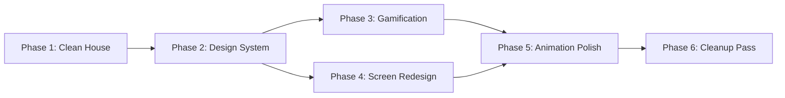

# CalCount Redesign Plan

> A clean, fresh, modern redesign with tasteful gamification — no fluff, no vestigial code.

---

## Current State Audit

### Redundancies Found
| Problem | Where | Details |
|---|---|---|
| **Two barcode scan entry points** | [logfood.tsx](file:///Users/levi/Code/caloriecount-expo/taesonco-calcount/src/app/(tabs)/logfood.tsx) + [cameraview.tsx](file:///Users/levi/Code/caloriecount-expo/taesonco-calcount/src/app/cameraview.tsx) | logfood has a "Scan" button inside the input *and* a `SearchModeSwapButton` FAB that navigates to cameraview. Two different paths to the same barcode lookup. |
| **Two gauge/ring components** | [ProgressRing.tsx](file:///Users/levi/Code/caloriecount-expo/taesonco-calcount/src/components/ProgressRing.tsx) + [Gague.tsx](file:///Users/levi/Code/caloriecount-expo/taesonco-calcount/src/components/Gague.tsx) | ProgressRing is used everywhere. RadialGauge is an orphan — half-circle gauge with hardcoded colors, never imported. |
| **Dead/stub screens** | [basepg.tsx](file:///Users/levi/Code/caloriecount-expo/taesonco-calcount/src/app/(tabs)/basepg.tsx), [about.tsx](file:///Users/levi/Code/caloriecount-expo/taesonco-calcount/src/app/(tabs)/about.tsx) | basepg is literally "About screen" text. about.tsx just shows login status. Both hidden (`href: null`). |
| **Two food result screens** | [fooddetail.tsx](file:///Users/levi/Code/caloriecount-expo/taesonco-calcount/src/app/fooddetail.tsx) + [multiresponse.tsx](file:///Users/levi/Code/caloriecount-expo/taesonco-calcount/src/app/multiresponse.tsx) | multiresponse handles all search results + has a barcode detail modal. fooddetail is a separate standalone product detail page — similar layout, both fetch from `/api/barcode/` or `/api/product/`. |
| **Workouts & Meds are static mockups** | [workouts.tsx](file:///Users/levi/Code/caloriecount-expo/taesonco-calcount/src/app/(tabs)/workouts.tsx), [meds.tsx](file:///Users/levi/Code/caloriecount-expo/taesonco-calcount/src/app/(tabs)/meds.tsx) | Fully hardcoded data, no backend, hidden tabs. Hardcoded Google avatar URLs, `#f97316` orange everywhere (not using theme tokens). |

---

## Phase 1 — Clean the House

> [!IMPORTANT]
> Remove dead weight first so every subsequent change has a smaller surface area.

- [ ] **Delete [Gague.tsx](file:///Users/levi/Code/caloriecount-expo/taesonco-calcount/src/components/Gague.tsx)** — orphan component, never imported
- [ ] **Delete [basepg.tsx](file:///Users/levi/Code/caloriecount-expo/taesonco-calcount/src/app/(tabs)/basepg.tsx)** — stub with no purpose, remove from tab layout
- [ ] **Delete [about.tsx](file:///Users/levi/Code/caloriecount-expo/taesonco-calcount/src/app/(tabs)/about.tsx)** — vestigial, remove from tab layout
- [ ] **Consolidate scan → single path**: Remove the inline "Scan" button from logfood's TextInput. Keep the `SearchModeSwapButton` FAB as the *one* way to launch [cameraview.tsx](file:///Users/levi/Code/caloriecount-expo/taesonco-calcount/src/app/cameraview.tsx). The logfood tab becomes purely text search + barcode input.
- [ ] **Consolidate food detail → single screen**: Retire [fooddetail.tsx](file:///Users/levi/Code/caloriecount-expo/taesonco-calcount/src/app/fooddetail.tsx). Route all product detail views through [multiresponse.tsx](file:///Users/levi/Code/caloriecount-expo/taesonco-calcount/src/app/multiresponse.tsx) + its `BarcodeDetailModal`, which already handles this better.
- [ ] **Clean tab layout**: Remove the `Tabs.Screen` entries for `about`, `basepg`, `workouts`, `meds` from [_layout.tsx](file:///Users/levi/Code/caloriecount-expo/taesonco-calcount/src/app/(tabs)/_layout.tsx)

---

## Phase 2 — Design System Refresh

> [!NOTE]
> Foundation work. Every visual change downstream depends on this.

- [ ] **Expand [tokens.ts](file:///Users/levi/Code/caloriecount-expo/taesonco-calcount/src/lib/theme/tokens.ts)** with gamification-ready tokens:
  - New semantic colors: `xpAccent`, `streakColor`, `levelGlow`, `progressTrail`
  - New spacing scale: `xs(4)`, `sm(8)`, `md(16)`, `lg(24)`, `xl(32)`
  - Typography scale: `heading1`, `heading2`, `body`, `caption`, `stat`
  - Border radius scale: `sm(8)`, `md(14)`, `lg(20)`, `pill(999)`
- [ ] **Upgrade [motion.ts](file:///Users/levi/Code/caloriecount-expo/taesonco-calcount/src/lib/motion.ts)** with richer animation presets:
  - `celebrationSpring` — for achievements/milestones (bouncier)
  - `microBounce` — for button feedback
  - `countUpTiming` — for number tickers
  - `shimmerTiming` — for skeleton loading states
- [ ] **Create `src/lib/theme/typography.ts`** — centralized text styles that respond to `fontPreferences`

---

## Phase 3 — Gamification Layer (Sophisticated, Not Childish)

> [!TIP]
> Think Strava/Apple Fitness energy: **earned satisfaction**, not sticker charts.

- [ ] **Daily streak counter** in the home header — small flame icon + count, animated pulse when streak continues
- [ ] **XP system** — earn XP for logging meals, hitting water targets, hitting macros. Show a thin XP bar at the top of the dashboard that fills through the day
- [ ] **Milestone toasts** — non-intrusive animated banners when you hit targets:
  - "🎯 Protein target hit" (smooth slide-in, auto-dismiss)
  - "💧 Hydration complete" (water ring fills, subtle glow)
  - "🔥 3-day streak!" (ember particle effect on streak icon)
- [ ] **Progress rings upgrade** — when a ring completes, animate a satisfying "completion pulse" (scale up briefly + glow). Don't change the ring itself, just add the celebration layer.
- [ ] **Macro cards** — add subtle gradient fills on the progress bars (instead of flat color). Protein = warm amber gradient, Carbs = blue gradient, Fats = purple gradient. Distinct but harmonious.

---

## Phase 4 — Screen-by-Screen Redesign

### Home Dashboard ([index.tsx](file:///Users/levi/Code/caloriecount-expo/taesonco-calcount/src/app/(tabs)/index.tsx))
- [ ] **Header**: Add streak counter next to avatar. Animate the "+" button with a micro-bounce on press.
- [ ] **Date navigation**: Add horizontal date dots (like Apple Activity) instead of just arrows. Selected day = accent-filled dot.
- [ ] **Calorie ring**: Keep centered, add subtle pulsing shadow when close to target (>80%).
- [ ] **Macro cards**: Give each macro its own color identity (amber/blue/purple gradient fills). Add animated number counters that tick up when data loads.
- [ ] **Water section**: Replace plain preset buttons with tactile pill-shaped buttons that animate a "splash" ripple on tap.
- [ ] **Quick-log search bar**: Integrate properly into the flow (glassmorphism-style frosted background).
- [ ] **Meals section**: Add stagger animation to meal items. Each meal category card enters with a slight delay.

### Log Food ([logfood.tsx](file:///Users/levi/Code/caloriecount-expo/taesonco-calcount/src/app/(tabs)/logfood.tsx))
- [ ] **Remove inline scan button** from the TextInput row. The camera FAB (`SearchModeSwapButton`) is the single entry point.
- [ ] **Unify the search interface**: Merge the Text/Barcode dropdown into a segmented control (using `ThemedSegmentedControl`).
- [ ] **Add recent searches** strip under the search bar (horizontal scroll chips).
- [ ] **Loading state**: Replace "Please Wait..." with a skeleton shimmer animation.
- [ ] **Add entry animation** for the page (slide up from bottom).

### Account ([account.tsx](file:///Users/levi/Code/caloriecount-expo/taesonco-calcount/src/app/(tabs)/account.tsx))
- [ ] **Profile header**: Add a level badge next to the username (e.g., "Lv. 12" in a subtle accent pill).
- [ ] **Stats summary row**: Add a compact row showing lifetime meals logged, streak record, days tracked.
- [ ] **Nutrition goals section**: Animate the macro bars on load. Add target completion percentage badges.
- [ ] **Settings card**: Clean up spacing, ensure consistent padding.

### Camera View ([cameraview.tsx](file:///Users/levi/Code/caloriecount-expo/taesonco-calcount/src/app/cameraview.tsx))
- [ ] **Scan overlay**: Add a focused scan box overlay with animated corner brackets (like modern QR scanners).
- [ ] **Loading state**: Replace plain ActivityIndicator with a pulsing scan-line animation over the camera.
- [ ] **Hardcoded colors** (#414141, white) → use theme tokens.

### Multi Response ([multiresponse.tsx](file:///Users/levi/Code/caloriecount-expo/taesonco-calcount/src/app/multiresponse.tsx))
- [ ] **Card stagger**: Already has basic `MotiView` animations, enhance with spring physics.
- [ ] **Empty state**: Add an illustrated empty state instead of plain text.

---

## Phase 5 — Animation & Polish

- [ ] **Page transitions**: Set up `react-native-screens` custom transitions — slide-up modals for detail views, cross-fade for tab switches.
- [ ] **Skeleton loading**: Create a reusable `SkeletonBlock` component using Reanimated shimmer. Replace all `ActivityIndicator` spinners in main views.
- [ ] **Haptic feedback**: Add subtle haptics on water button taps, meal swipes, and achievement unlocks (via `expo-haptics` if not already installed).
- [ ] **Pull-to-refresh**: Enhance with a custom animated indicator (the current one is bare `RefreshControl`).

---

## Phase 6 — Cleanup & Consistency Pass

- [ ] **Audit all hardcoded colors** — workouts.tsx and meds.tsx are full of `#f97316`, `#d3e4fe`, `#2c3e50`. Everything must use theme tokens.
- [ ] **Ensure dark mode parity** — test all new components in both `iosLight` and `iosDark` themes.
- [ ] **Remove unused imports and dead code** across all files.
- [ ] **Verify typed routes** compile cleanly after removing screens.

---

## Execution Order

> [!CAUTION]
> Phase 1 must go first — it shrinks the codebase and prevents wasted effort styling dead code.
> Phase 2 must precede 3+4 — new tokens and typography must exist before screens reference them.
